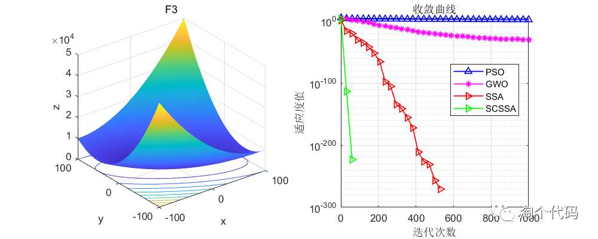
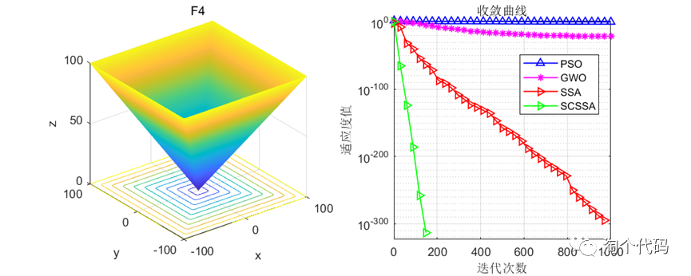
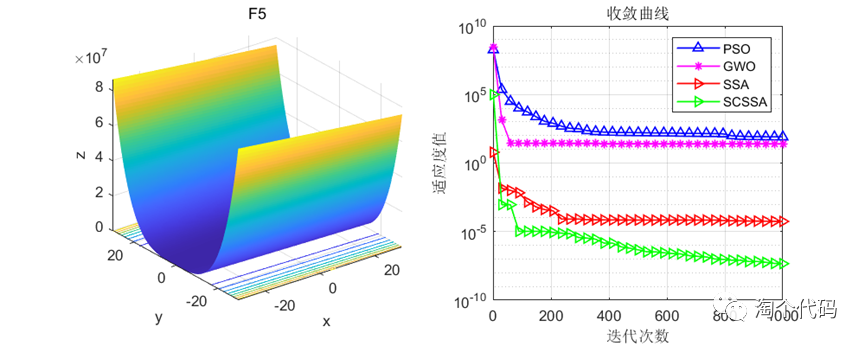

# The Sparrow Search Algorithm with Integrated Cosine and Cauchy Variation

Today's main subject is the Sparrow Search Algorithm with Positive Cosine and Cauchy Variation, which is an optimization algorithm for sparrows.

Improvements to the basic Sparrow Algorithm are as follows:
1. The initialization of individual sparrows in the Sparrow Algorithm is based on a refraction back-learning strategy. The basic idea is to expand the search range by computing the backward solution of the current solution to find better candidate solutions for the given problem;
2. The discovery position update formula in the original Sparrow Algorithm is replaced with a positive cosine strategy. When the food searched by the discoverer is at a local optimum, a large number of followers will flock to this position, causing the discoverer and the entire population to stop progress, resulting in a loss of diversity in the population position;
3. An improvement is made to the step size search factor of the positive cosine strategy; the original step size search factor shows a linear declining trend, which is not conducive to further balancing the global search and local development capabilities of SSA.
4. The follower position update formula in the original Sparrow Algorithm is replaced with a Cauchy variation strategy. The Cauchy distribution is similar to the standard normal distribution, being a continuous probability distribution with values near zero at the origin, relatively long and thin at both ends, approaching zero slowly, hence it can generate greater perturbation compared to the normal distribution. Therefore, using Cauchy variation to perturb individuals in the position update of the sparrows can expand the search scale of the Sparrow Algorithm, thereby enhancing the ability of the algorithm to escape from local optima.
Principle formulas and ideas refer to:
References: [1] Li Ailian, Quan Lingxiang, Cui Guimei, et al. Integrating Positive Cosine and Cauchy Variation into the Sparrow Search Algorithm[J]. Computer Engineering and Applications, 2022, 58(3): 91-99.
Test results on the CEC2005 function set show that the improved algorithm proposed in this paper (SCSSA) outperforms the original Sparrow Optimization Algorithm (SSA), Grey Wolf Optimization Algorithm (GWO), and Particle Swarm Optimization Algorithm (PSO).
The algorithm was tested 1000 times, with each particle set to 100.
Results analysis: In the tests of single peak and multi-peak functions, it can be seen that the improved idea mentioned in this paper is indeed strong, and you can also apply the Cauchy variation and positive cosine strategy to other algorithms for improvement.
Code demonstration:
%% \nclear all \nclose all\nclc\nN=100; % Number of search agents\nFunction_name='F1'; % Name of the test function, range from F1-F23\niter=1000; % Maximum number of iteration times\n\n% Load details of the selected benchmark function\n[lb,ub,dim,fobj]=CEC2005(Function_name);\n\n%% SSA\n[fMin , bestX,SSA_Convergence_curve ] =SSA(N,iter,lb,ub,dim,fobj);\ndisplay(['The best optimal value of the objective funciton found by SSA  for ' [num2str(Function_name)],'  is : ', num2str(fMin)]);\nfprintf ('Best solution obtained by SSA: %s\n', num2str(bestX,'%e  '));\n\n%% GWO\n[Best_score,Best_pos,PSO_curve]=PSO(N,iter,lb,ub,dim,fobj);  % Calculating the solution of the given problem using PSO\ndisplay(['The best optimal value of the objective funciton found by PSO  for ', [num2str(Function_name)],'  is : ', num2str(Best_score)]);\nfprintf ('Best solution obtained by PSO: %s\n', num2str(Best_pos,'%e  '));\n%% gwo\n[Alpha_score,Alpha_pos,GWO_Convergence_curve]=GWO(N,iter,lb,ub,dim,fobj);  % Calculating the solution of the given problem using gwo\ndisplay(['The best optimal value of the objective funciton found by GWO  for ', [num2str(Function_name)],'  is : ', num2str(Alpha_score)]);\nfprintf ('Best solution obtained by GWO: %s\n', num2str(Alpha_pos,'%e  '));\n\n%% SCSSA\n[SCSSA_fMin , SCSSA_bestX,SCSSA_Convergence_curve ] =SCSSA(N,iter,lb,ub,dim,fobj);\ndisplay(['The best optimal value of the objective funciton found by SCSSA  for ' [num2str(Function_name)],'  is : ', num2str(SCSSA_fMin)]);\nfprintf ('Best solution obtained by SCSSA: %s\n', num2str(SCSSA_bestX,'%e  '));\n%Draw objective space\n %% Figure\nfigure1 = figure('Color',[1 1 1]);\nG1=subplot(1,2,1,'Parent',figure1);\nfunc_plot(Function_name)\ntitle(Function_name)\nxlabel('x')\nylabel('y')\nzlabel('z')\nsubplot(1,2,2)\nG2=subplot(1,2,2,'Parent',figure1);\nCNT=35;\nk=round(linspace(1,iter,CNT)); % Randomly select CNT points\n% Note: If the number of points drawn on the convergence curve is small, and the random points are sparse, it indicates that the number of points has been insufficient. At this time, the number of points should be increased gradually, such as 100, 200, 300, etc.\n% On the contrary, if the random points on the convergence curve are very dense, it indicates that too many points have been taken. At this time, the number of points should be reduced.\niter=1:1:iter;\nsemilogy(iter(k),PSO_curve(k),'b-^','linewidth',1);\nhold on\nsemilogy(iter(k),GWO_Convergence_curve(k),'m-*','linewidth',1);\nhold on\nsemilogy(iter(k),SSA_Convergence_curve(k),'r->','linewidth',1);\nhold on\nsemilogy(iter(k),SCSSA_Convergence_curve(k),'g->','linewidth',1);\ngrid on;\ntitle('Converging curve')\nxlabel('Iteration count');\nylabel('Fitness value');\nbox on\nlegend('PSO','GWO','SSA','SCSSA')\nset (gcf,'position', [300,300,800,320])\n  
function [fMin , bestX,Convergence_curve ] = SSA(pop, M,c,d,dim,fobj  )\nP_percent = 0.2;    % The population size of producers accounts for "P_percent" percent of the total population size\npNum = round( pop *  P_percent );    % The population size of the producers\nlb= c.*ones( 1,dim );    % Lower limit/bounds/     a vector\nub= d.*ones( 1,dim );    % Upper limit/bounds/     a vector\n%Initialization\nfor i = 1 : pop\n    x( i, : ) = lb + (ub - lb) .* rand( 1, dim );\n    fit( i ) = fobj( x( i, : ) ) ;\nend\npFit = fit;\npX = x;                            % The individual's best position corresponding to the pFit\n[ fMin, bestI ] = min( fit );      % fMin denotes the global optimum fitness value\nbestX = x( bestI, : );             % bestX denotes the global optimum position corresponding to fMin\n% Start updating the solutions.\nfor t = 1 : M\n    [ ans, sortIndex ] = sort( pFit );% Sort.\n    [fmax,B]=max( pFit );\n    worse= x(B,:);\n    r2=rand(1);\n    if(r2<0.8)\n        for i = 1 : pNum                                                   % Equation (3)\n            r1=rand(1);\n            x( sortIndex( i ), : ) = pX( sortIndex( i ), : )*exp(-(i)/(r1*M));\n            x( sortIndex( i ), : ) = Bounds( x( sortIndex( i ), : ), lb, ub );\n            fit( sortIndex( i ) ) = fobj( x( sortIndex( i ), : ) );\n        end\n    else\n        for i = 1 : pNum\n\n            x( sortIndex( i ), : ) = pX( sortIndex( i ), : )+randn(1)*ones(1,dim);\n            x( sortIndex( i ), : ) = Bounds( x( sortIndex( i ), : ), lb, ub );\n            fit( sortIndex( i ) ) = fobj( x( sortIndex( i ), : ) );\n        end\n    end\n    [ fMMin, bestII ] = min( fit );\n    bestXX = x( bestII, : );\n    for i = ( pNum + 1 ) : pop                     % Equation (4)\n        A=floor(rand(1,dim)*2)*2-1;\n        if( i>(pop/2))\n            x( sortIndex(i ), : )=randn(1)*exp((worse-pX( sortIndex( i ), : ))/(i)^2);\n        else\n            x( sortIndex( i ), : )=bestXX+(abs(( pX( sortIndex( i ), : )-bestXX)))*(A'*(A*A')^(-1))*ones(1,dim);\n        end\n        x( sortIndex( i ), : ) \n= Bounds( x( sortIndex( i ), : ), lb, ub );\n        fit( sortIndex( i ) ) = fobj( x( sortIndex( i ), : ) );\n    end\n    c=randperm(numel(sortIndex));\n    b=sortIndex(c(1:20));\n    for j =  1  : length(b)      % Equation (5)\n        if( pFit( sortIndex( b(j) ) )>(fMin) )\n            x( sortIndex( b(j) ), : )=bestX+(randn(1,dim)).*(abs(( pX( sortIndex( b(j) ), : ) -bestX)));\n        else\n            x( sortIndex( b(j) ), : ) =pX( sortIndex( b(j) ), : )+(2*rand(1)-1)*(abs(pX( sortIndex( b(j) ), : )-worse))/ ( pFit( sortIndex( b(j) ) )-fmax+1e-50);\n        end\n        x( sortIndex(b(j) ), : ) \n= Bounds( x( sortIndex(b(j) ), : ), lb, ub );\n        fit( sortIndex( b(j) ) ) = fobj( x( sortIndex( b(j) ), : ) );\n    end\n    for i = 1 : pop\n        if ( fit( i ) < pFit( i ) )\n            pFit( i ) = fit( i );\n            pX( i, : ) = x( i, : );\n        end\n        if( pFit( i ) < fMin )\n            fMin\n= pFit( i );\n            bestX = pX( i, : );\n        end\n   end\n    Convergence_curve(t)=fMin;\nend\n% Application of simple limits/bounds\nfunction s = Bounds( s, Lb, Ub)\n% Apply the lower bound vector\ntemp = s;\nI = temp < Lb;\ntemp(I) = Lb(I);\n% Apply the upper bound vector\nJ = temp > Ub;\ntemp(J) = Ub(J);\n% Update this new move\ns = temp;\n  

## Images

<!-- PAYMENT_BLOCK -->

## Get this dataset

- Payment link (Stripe): [Buy now](https://buy.stripe.com/3cs8yP7sY87d0vu9AB)
- Payment QR code: 

<!-- /PAYMENT_BLOCK -->
